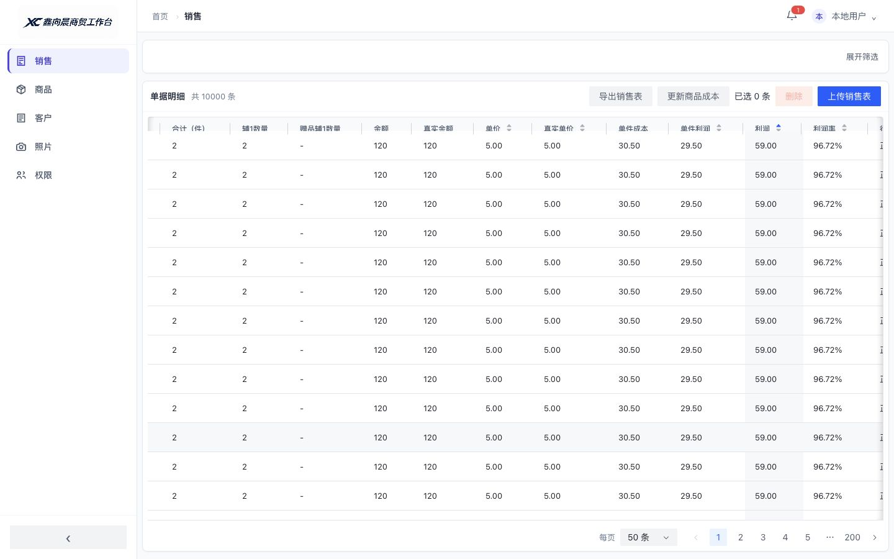

# 销售性能优化与基准 · 2026-11-08

## 实施范围

保持筛选、全量利润排序、分页、导出和政策分配口径。默认每页100改为50，页面可选20/50/100；后端原500/1000参数保留兼容。原始销售与业务库没有结构迁移。

瓶颈实测为每次读取全部销售、校验分配签名、反序列化成本，以及利润排序重复计算；前端1000行会生成约31000个单元格。本轮先消除重复工作，不增加虚拟滚动、持久化缓存表或新的UI依赖。

## 缓存与失效

- SQLiteRevisions用独立只读连接的PRAGMA data_version观察产品及销售库提交，支持WAL和其他连接/进程写入；文件替换通过设备/inode识别，不用时间阈值猜测数据是否变化。
- PolicyCostAllocator仅缓存稳定读取的分配结果；强制及指定月份核算仍走原流程。重建自身会写政策用量，保守地等待下一次稳定读取才缓存，避免把外部提交误当作自己的写入。
- SalesProfitQuery只保留最近一组筛选快照，复用成本版本观察连接，并缓存三列双向排序的记录引用。普通字段仍由SQLite排序，利润仍按原Decimal口径计算。翻页仅复制当前页，返回对象修改不会污染缓存。
- 销售导入、删除、商品成本/规格及政策变化提交后，快照和排序失效；同值按ID稳定排序，空值始终最后。保留COST_LOCK串行边界，不引入后台任务或过期数据窗口。
- 缓存是进程内单快照，内存随匹配数据量增长，进程重启后重新计算；不是无限条目缓存。超过1万条或多进程部署应另外评估内存及冷查询时间。

## 1万条实测

同机系统Python，隔离SQLite，50条/页。下列服务层时间不含浏览器渲染、HTTP序列化和真实网络延迟。

| 场景 | 修改前重复请求 | 修改后缓存命中 |
|---|---|---|
| 普通查询 | 297–345ms | 1.3–1.5ms |
| 利润排序 | 460–516ms | 1.3–1.4ms |
| 利润排序第2页 | 460–520ms | 1.3–1.4ms |

新临时库首次查询约730ms、下一次稳定校验约482ms，随后命中缓存；首次利润排序建立顺序约24ms。首次打开、换筛选和数据修改后仍可能需要完整计算，不能把缓存命中时间当作所有请求的耗时。

真实本机HTTP（5182，合成数据、50条）暖请求约4–5ms，包含JSON及本机传输；切换到未缓存筛选时约0.55秒。该测量发生在筛选键统一清理前，最终版本还复用未排序/利润排序的同一筛选快照。

## 浏览器与正确性验收

- 1万条独立预览：总数10000、默认50条、200页，只渲染50行/1550个单元格；利润排序、第2页和收起筛选可用，控制台无错误。
- 142项后端测试通过；新增缓存命中不重复读取、返回值隔离、产品外部连接WAL提交、政策创建、强制重算、导入及删除失效，保留三列升降序与跨页空值测试。前端check/build及git diff --check通过。
- 浏览器自动化未开放精确渲染时间采集，因此本记录不声称测得帧率或客户端渲染毫秒数；未测试真实Mac触控板、多进程压测及断电恢复。
- 同步本机8765现有数据环境，仅重启服务加载代码；没有导入合成样本到output。用户已授权将本轮性能优化提交并推送至当前开发分支，提交不包含业务数据或环境密钥。

## 复现

在InfoLens目录执行`python3 scripts/benchmark_sales.py`，自动使用临时库生成10000条数据，输出5次查询计时并清理临时数据。数据构造与上传时间不计入查询耗时。

浏览器样本运行`python3 scripts/preview_ui.py --sales-rows 10000 --port 5182`，只绑定127.0.0.1，使用独立临时目录。正式环境不运行该脚本。

回滚范围为版本观察器、成本/查询缓存、API装配及销售分页默认值，重新构建并重启服务；无业务数据迁移。
